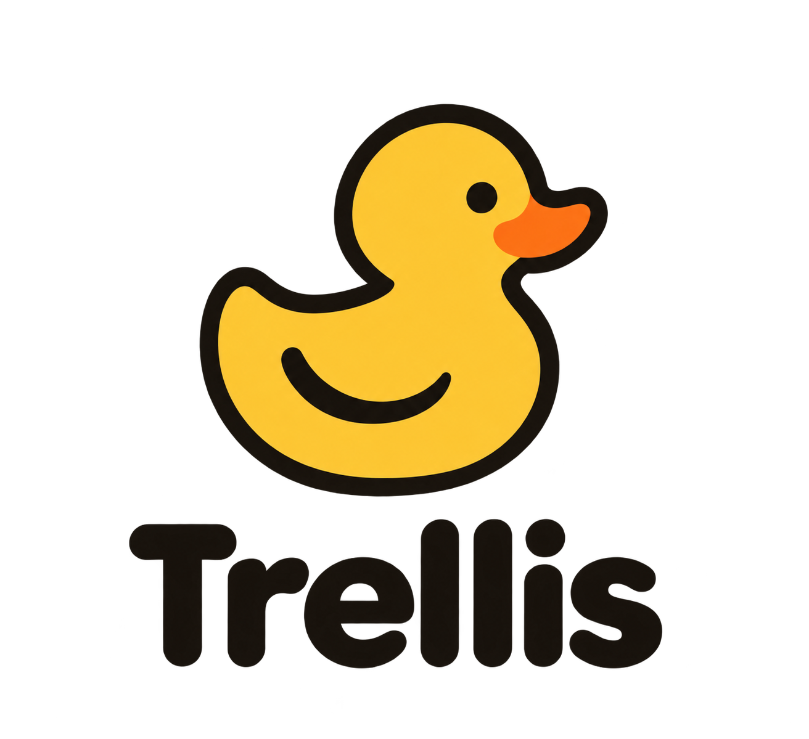

<p align="center">
  
</p>

# Trellis · CS 1301

Trellis uses a rubber duck as its logo, a reference to rubber-duck debugging.

This repository is an implementation starter for a Georgia Tech CS 1301 learning and assessment platform. Git contains platform source code. Normal lesson content, question configuration, exercise files, graders, and publishing history belong in PostgreSQL and private object storage and are edited through the web application.

See [Updating Trellis](docs/UPDATING.md) for the VS Code, GitHub, and Azure deployment workflow.
See [Azure POC grader](docs/azure-grader.md) for the dedicated execution VM, isolation checks, worker updates and Run/Submit controls.

See [Staff REST API](docs/REST_API.md) for scoped access tokens, course/content editing, grade exports, enrollment changes, activity timestamps and grader migration. In Trellis, open **Course settings → API access**.

See [Native grader uploads](docs/NATIVE_GRADER_UPLOADS.md) for Ferb-to-native conversion reports and the resumable API uploader.

## What is implemented

- Django models for courses, roles, LTI identities, accommodations, lessons, immutable revisions, activity files, imports, submissions, and idempotent grade events.
- A strict student projection that sends only published content and files marked `student`. Correct answers, feedback, solutions, staff files, and grader files remain private.
- React course interface with Monaco, course navigation, native multiple-choice checking, browser file create/edit/rename/delete/upload, saved private workspaces, instruction editing, draft history, and explicit publishing. Preview and Learn use the same renderer and student projection.
- Loss-aware edX parser skeleton for multiple choice, select-all, option dropdowns, string/FITB, numerical responses, inline formatting, code, choice hints, and solutions.
- Kaltura CSV parser that extracts entry, partner, UI configuration, and widget IDs instead of storing arbitrary iframe HTML.
- Separate Vocareum ZIP inspection with traversal and size checks. Known grader/solution files are private and ambiguous files are quarantined for staff review.
- Redis/Celery grade event skeleton with idempotency and exponential retry state.
- An authenticated execution queue and separate host worker using disposable Docker sandboxes. Run displays Python output; Submit records points, replaces feedback files, and releases configured sample answers after full success.
- First-party grading core, independent of the legacy grading helpers. See [first-party grading](docs/FIRST_PARTY_GRADING.md) for supported checks.
- Imported course hierarchy, authenticated image delivery, Kaltura embeds, lesson/problem-set navigation, viewed/completed markers, and assignment progress.

## Local development

Copy `.env.example` to `.env`, then run:

```bash
docker compose up --build
```

The frontend is at `http://localhost:5173` and Django at `http://localhost:8000`.
The backend container applies committed database migrations whenever it starts.
Development ports bind only to this Mac. The local instructor login requires both
DEBUG and ALLOW_LOCAL_LOGIN; Compose enables the latter only for the web service.

Seed the local pilot using an extracted coding archive (no source content enters Git):

```bash
docker compose cp ../downloaded_part_5591043 backend:/tmp/studio-source
docker compose exec backend python manage.py seed_studio --source /tmp/studio-source
```

Open the frontend and choose **Open local workspace**. Learn saves a personal
workspace; Config saves new draft revisions; Publish makes a saved revision live.
Students can edit existing files only. File creation, upload, rename, and deletion
are restricted to Config. Reset workspace restores the exact original file set and
contents, including feedback/sample placeholders. Preview opens only the selected
exercise from Config and uses temporary state separate from saved workspaces.
The Local coding lab includes Days Between Dates with first-party tests. Start the
execution worker in a second terminal with `sh scripts/start-worker.sh` after installing
the backend requirements in `.venv`. Set a random `RUNNER_TOKEN` in `.env` and recreate
the backend when that value changes. The worker reads the same secret. It runs on
the Mac; the app container never receives the Docker socket. Restart this worker
after runner changes. The Compose `runner-controller` is an unused fail-closed stub.
Native and coding submissions record local progress and points. Canvas passback
is still a stub and no scores are sent to Canvas.

Native submissions display compact decimal scores and return the XML's choice hints
only after an attempt, including selected/unselected feedback for select-all items.
The 72 imported sandboxes are ungraded Python workspaces with Run and reset; both
submission endpoints reject sandbox grading. Retired Vocareum instructional content
is removed from the active course while source records remain in history.

Current in-scope source: 1,633 components across 21 sections: 433 readings, 408 Kaltura
videos, 433 native question components, and 359 coding activities. Supplemental,
turtle, SmartBook, and feedback-survey sections are soft-deleted and excluded from
future imports. Nineteen image assets were resolved with no missing image references.

Consecutive text/video components within each source lesson unit share a single
navigation part, retaining their original block order. Exercises break these groups
and stay separate. The grouping pass combined 141 presentation parts and removed
463 redundant navigation entries; all original revisions and source records remain.
Two custom-script polls were converted to native ungraded responses. Config exposes source and import
warnings. Source content, reports, and media remain outside Git.

Nested response prompts and code blocks are preserved. Kaltura embeds use the CSV's
player, widget, and entry IDs with iframe mode enabled; captions and transcript
controls were verified in the browser. Coding feedback shows expected and observed
values, and full-credit submissions show the success message and available sample
answers below the workspace. Grader implementation files remain restricted to staff.

Verify the full submission path while the worker is running:

```bash
docker compose exec -T backend python manage.py shell < scripts/smoke_execution.py
```

This creates and cleans up an isolated test account, verifies full points, feedback
replacement, sample release, and completion without modifying a learner's workspace.

## Programming quizzes

The six programming quizzes are imported from Vocareum course 144164. Each quiz
contains five questions with unlimited Run and Submit attempts while its exam is
open. Staff can enable exam mode, set the standard time limit, and assign
coursewide or quiz-specific extra time from Course settings. The server owns the
attempt start and expiration time, so refreshing the browser does not restart the
clock. Submitting the whole quiz closes student access to the quiz; the student
sees only the earned and possible points. The course Gradebook shows every student
and assignment in a scrollable score grid, with student and assignment search
views. Staff can open a score to inspect native responses or the latest coding
workspace, then Run or Submit an isolated review copy without changing the
student's files or grade. Quiz timing remains in Course settings; student-work
review lives in the Gradebook.

The course homepage lists lessons, problem sets, and programming quizzes with live
progress and point totals. Staff can switch the homepage into structure-editing
mode to add, copy, or soft-delete sections and parts. These changes are stored in
PostgreSQL and stay separate from the platform source repository.

The migration has three explicit stages:

```bash
python3 scripts/download_vocareum_programming_quizzes.py
docker build -t cs1301-student-python:local runner/sandbox
python3 scripts/prepare_programming_quizzes.py
docker compose exec -T backend python manage.py import_programming_quizzes
```

The download keeps the source ZIPs outside Git. Preparation reads legacy files
only to discover inputs, then runs staff answers in the isolated sandbox to
produce platform-owned declarative test cases. Imported activities contain the
student Python file, `full_results.txt`, an optional staff solution, and the
Trellis grading definition. Vocareum lifecycle shell scripts, `Ferb.py`,
`Utility.py`, `publicdata`, bytecode, and `BadLines.txt` are not installed.

## Course coding archive import

The bulk exporter stores downloaded source under the ignored
`var/vocareum-coding-archives/` directory. Imported activity files are versioned
in PostgreSQL and stored as private Django media objects under
`private-media/activity-files/`; Config is the supported way to inspect and edit
them. The active grading engine is platform source in `runner/grading/`.

The repeatable bulk pipeline is:

```bash
python3 scripts/download_vocareum_coding_exercises.py
python3 scripts/prepare_programming_quizzes.py \
  --root var/vocareum-coding-archives \
  --glob 'exercises/*/*/manifest.json'
docker compose exec -T backend python manage.py import_vocareum_coding_archives
```

Preparation reads the legacy grader only to discover safe literal inputs and
uses a staff answer as an oracle inside the isolated runner. Import never installs
or executes Ferb, Vocareum lifecycle scripts, or shared legacy helpers. A ready
activity gets `grader/tests.json`; one that cannot be converted safely gets
`grader/import-review.json` and remains runnable but cannot be submitted until a
staff member supplies first-party tests. Private answers are stored under
`solutions/` and are never returned in the student projection.

For backend tests without Docker:

```bash
python -m venv .venv
.venv/bin/pip install -r requirements.txt
cd backend && ../.venv/bin/python manage.py test
```

Audit the supplied course digest without changing it or the database:

```bash
cd backend
../.venv/bin/python manage.py audit_course_source ../.. --output ../var/migration-audit.json
```

## Source migration strategy

Current migration scope excludes the top-level practice test and practice quiz sections, Course Information, and Course Surveys & Extra Credit. Their entire subtrees are skipped. Other numbered course sections remain included; the Kaltura catalog is still used for video mapping. The shared filter lives in `backend/core/importers/scope.py`, and audit reports list included and excluded sections. Existing source files stay in place.

The discovered course source contains a usable `course_structure.csv`, 2,047 XML files, hundreds of HTML components, 412 local videos with captions, 712 multiple-choice responses, 166 select-all responses, 463 string responses, 111 numerical responses, and 93 option responses. The Kaltura catalog is keyed by stable course names such as `1.1.1.0`.

The production importer should run as a staged job:

1. Read the exported hierarchy and create unpublished lesson/activity candidates.
2. Parse non-coding XML into native blocks and private grading rules. Preserve the raw XML and every warning.
3. Resolve video display names against the Kaltura catalog and create native Kaltura blocks. Unmatched or duplicate names require review.
4. Follow coding LTI references through a separate coding-archive path. Preserve the source archive and checksum, inspect it safely, and require staff classification for ambiguous files.
5. Show original source, imported student rendering, private grading summary, and warnings in a review screen.
6. Allow publishing only after warnings and quarantined files are resolved.

Do not import local token files, environment files, generated logs, student/grade CSVs, or credentials. The supplied source tree includes material in several of these categories.

## Practical implementation plan

### Milestone 1 — migration-quality content core

Finish the schema and import command against a representative fixture set from every response type. Add HTML/list/image/table support, Kaltura resolution, a review queue, version comparison, soft delete/restore, and publish controls. This proves that the course can be represented without flattening it into Markdown.

### Milestone 2 — authoring and assessment

Build block forms, ordering, draft autosave, a Monaco-based coding file manager, attempt recording, native question grading, accessibility checks, and the shared student renderer. File mutations create new revision state; hidden files are never returned by student endpoints.

### Milestone 3 — Canvas LTI Advantage

Implement OIDC login initiation, signed LTI 1.3 launch validation, deployment registration, course/resource binding, NRPS roster sync, AGS line-item mapping, and deep linking. Store Canvas subject IDs as identity keys. On every committed score change, create one grade event and enqueue it with `transaction.on_commit`; make the AGS request idempotent and expose pending/retrying/failed status to staff.

### Milestone 4 — isolated Python execution

Define a signed runner job contract and dispatch attempts to disposable sandboxes outside the web/Celery containers. Use immutable images, a non-root user, read-only root filesystem, network disabled by default, CPU/memory/PID/time/output limits, per-attempt files, and short-lived credentials. Hidden graders are injected only inside the sandbox. Obtain an independent security review before a student pilot.

### Milestone 5 — pilot readiness

Add audit logs, backups and restore drills, FERPA-conscious retention, accessibility testing, observability, load tests, incident playbooks, staff role controls, accommodations, grade reconciliation, and a staged Canvas pilot alongside the existing platform.

## Known incomplete areas

This starter is not production-ready. LTI signature validation/OAuth, AGS network calls, production object storage, distributed runner deployment, audit logging, and a dedicated migration review queue remain to be implemented. Config currently uses structured JSON editors for content and grading. The local worker supports batch execution, not an interactive terminal accepting input while a program runs. The explicit Canvas stubs fail closed.

See [`docs/ARCHITECTURE.md`](docs/ARCHITECTURE.md) for component and data-flow decisions and [`docs/SECURITY.md`](docs/SECURITY.md) for the enforced and pending security boundaries.
